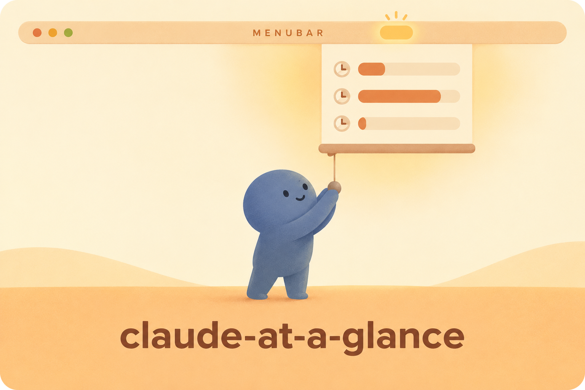

<!--
GitHub metadata, applied in repo Settings (not rendered):
About: Track Claude session, weekly & per-model usage limits with reset times from the macOS menu bar — a native Swift/SwiftUI MenuBarExtra app on Claude Code's own login & usage endpoint.
Topics (ranked): claude, claude-code, anthropic, usage-tracker, rate-limits, menu-bar, menubar-app, macos, macos-app, swift, swiftui, menubarextra, developer-tools, productivity, ai-tools
Social preview: docs/media/hero-glass.jpg from docs/media/hero.png
-->

# Claude at a Glance — Usage Menu Bar App for macOS

**Your Claude Code limits, one click away.**  
*A tiny menu bar app that mirrors Claude Code's `/usage` screen: session and weekly bars with reset times, and your session percent in the menu bar.*




| I want to… | Where | What it is |
|---|---|---|
| **See my limits without typing `/usage`** | [`Sources/ClaudeAtAGlance`](Sources/ClaudeAtAGlance) | The menu bar app: popover with one bar per limit |
| **Build the app** | [`scripts/build-app.sh`](scripts/build-app.sh) | Produces `build/Claude at a Glance.app` |
| **Reuse the logic** | [`Sources/GlanceCore`](Sources/GlanceCore) | Parser, reset formatter, credential reader, usage client, store |
| **Check it works** | [`Tests/GlanceCoreTests`](Tests/GlanceCoreTests) | XCTest suite with a sanitized fixture |

## Download

1. Get the latest `Claude-at-a-Glance-<version>.zip` from [Releases](https://github.com/AdinathChaudhari/claude-at-a-glance/releases/latest) and unzip it.
2. **Drag the app to Applications.**
3. **Open it once.** The app is not notarized, so macOS asks first: on macOS 15 or later, go to System Settings, Privacy & Security, and click **Open Anyway**. This is a one-time step.
4. **Updates are announced in the menu.** About once a day the app checks GitHub, and shows "Update available" in its popover when a newer version exists. That one request to GitHub is the only other network call it makes.

No release yet, or you would rather build it yourself? Use the quick start below.

## Quick start

```bash
git clone https://github.com/AdinathChaudhari/claude-at-a-glance.git
cd claude-at-a-glance
scripts/build-app.sh
open "build/Claude at a Glance.app"
```

1. **Sign in to Claude Code** once, in a terminal, if you have not already.
2. **Build and open** the app with the commands above. A percentage appears in the menu bar.
3. **Click the percentage** to see every limit with its reset time.
4. **Add it to Login Items** by hand: System Settings, General, Login Items, then add the app.

That's it. Everything below is detail.

---

## Demo

The logic is covered by tests that run against a sanitized sample response with made-up numbers. A real run of the suite:

```text
$ swift test
	 Executed 7 tests, with 0 failures (0 unexpected)     # reset formatter
	 Executed 1 test, with 0 failures (0 unexpected)      # fixture loads
	 Executed 10 tests, with 1 test skipped and 0 failures (0 unexpected)    # parser (1 opt-in live test skipped)
	 Executed 4 tests, with 0 failures (0 unexpected)     # store: polling, debounce, backoff
	 Executed 3 tests, with 0 failures (0 unexpected)     # update checker
	 Executed 2 tests, with 0 failures (0 unexpected)     # update state
	 Executed 27 tests, with 1 test skipped and 0 failures (0 unexpected)
```

---

## What it shows

- **Menu bar:** your current session percent, for example `13%`. It shows `–` until the first data arrives, and adds `⚠` when the data is stale or the last refresh failed. The text is tinted orange or red when any limit is near its cap.
- **Popover (about 320 pt wide):** one row per limit, in the same order as `/usage`.
  - **Current session**
  - **Current week (all models)**
  - **Current week (a specific model)**, one row per model-scoped weekly limit
- **Each row:** a bold label, a horizontal bar, "N% used" on the right, and "Resets 2:40pm" (same day) or "Resets Nov 29 at 5:30am" underneath, in your local time zone.
- **Colours:** blue normally, orange from 75%, red from 90%, or whatever severity the server reports.
- **Footer:** "Updated <time>", a Refresh button, and a Quit button.

The popover looks like this, with illustrative numbers:

```
Current session                        42% used
[#################-----------------------]
Resets 2:40pm

Current week (all models)              18% used
[#######---------------------------------]
Resets Nov 29 at 5:30am

Updated 10:41am                [Refresh] [Quit]
```

## How it gets data

1. **Reads Claude Code's existing login** from the macOS Keychain, by running `/usr/bin/security find-generic-password` for the `Claude Code-credentials` item.
2. **Calls the same usage endpoint** that `/usage` uses, with that token, over HTTPS to `api.anthropic.com`.
3. **Draws the answer.** It never refreshes the token, never writes to the Keychain, and never stores the token anywhere. It reads the token again on each poll and never logs it.

Polling: every 60 seconds, plus a refresh when you open the popover if the data is older than 15 seconds. The Refresh button waits 10 seconds between presses. If the server answers with rate-limit or server errors, the app backs off for 5, then 10, then 20 minutes, and returns to 60 seconds after the first success.

> **Caveat: the endpoint is unofficial.** It is the one Claude Code itself calls, but it is not a documented public API. Anthropic can change or remove it at any time, and this app would then stop working until it is updated. The parser is deliberately lenient, and when the format changes in a way it cannot read, the app says so instead of showing wrong numbers.

### Privacy

- Nothing leaves your Mac except the request to Anthropic's usage endpoint, made with your own Claude Code token, and a once-a-day check of this repo's latest GitHub release (no token, no personal data).
- There is no analytics, no telemetry, no server of mine, and no third party.
- The token is held in memory for the duration of a request. It is not written to disk, logged, or sent anywhere else.
- The app is open source so you can check all of this: the Keychain read lives in [`CredentialReader.swift`](Sources/GlanceCore/CredentialReader.swift) and the request in [`UsageClient.swift`](Sources/GlanceCore/UsageClient.swift).

## States and troubleshooting

| You see | What it means | What to do |
|---|---|---|
| `–` in the menu bar | No data yet | Wait a few seconds, or click Refresh |
| "Claude Code not signed in." | No Claude Code login found in the Keychain | Run `claude` in a terminal and sign in |
| "Login expired. Open Claude Code to refresh." | The token has expired, or the server rejected it | Open Claude Code once; it refreshes its own login, and the app picks it up on the next poll |
| "Offline, retrying." | The request could not reach Anthropic | Check your connection; it retries on its own |
| "Usage format changed. Update the app." | The endpoint now returns something the parser cannot read | Pull the latest version and rebuild, or open an issue |
| Dimmed values with "as of <time>" | The last refresh failed, so these are the last good numbers | Fix the cause shown above |
| A Keychain prompt appears | macOS is asking whether the app may read the Claude Code item | Allow it; "Always Allow" avoids asking again |

## Requirements

- macOS 14 or later
- To build from source: Xcode command line tools with Swift 6 (`xcode-select --install`). Not needed for the downloaded app.
- Claude Code installed and signed in (a Claude subscription login, not an API key)

## Roadmap

- **Launch at login** as a built-in toggle, so the manual Login Items step goes away
- **Extra-usage spend row**, if the endpoint exposes it reliably
- Hover details, if a future macOS lets menu bar extras support it

## License

MIT. See [LICENSE](LICENSE).

This is an independent project. It is not made by, affiliated with, or endorsed by Anthropic. "Claude" is a trademark of Anthropic.
